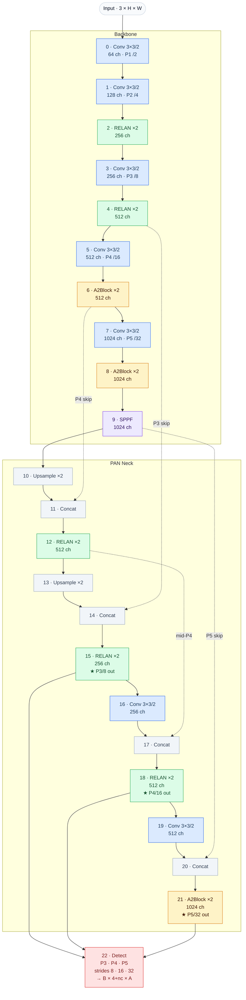

# Model — `trainer.detection.nn`

## Overview

The neural network subsystem lives in `trainer/detection/nn/`. It contains:

- `model.py` — `DetectionModel`: builds an `nn.Module` graph from a TOML config via the module registry.
- `loss.py` — `DetectionLoss` and `TaskAlignedAssigner`: training objective.
- `registry.py` — `register_module` / `get_module`: maps string names to module classes.
- `modules/` — individual building blocks (Conv, heads, attention, pooling, RELAN/CSP).

---

## Architecture — `trainer` (default)

The default model (`trainer.toml`) is a **PAN-Net** detector with a RELAN + Area-Attention backbone and a bidirectional feature-pyramid neck. Three output scales feed a shared anchor-free `Detect` head.

### Full architecture diagram

> Mermaid renders natively on GitHub, GitLab, Obsidian, and most modern markdown viewers.



**Legend**

| Colour | Block type |
|---|---|
| Blue | `Conv` — Conv2d + BN + SiLU |
| Green | `RELAN` — Residual ELAN (split → bottlenecks → aggregate) |
| Amber | `A2Block` — Area-attention augmented aggregation |
| Purple | `SPPF` — Spatial Pyramid Pooling Fast |
| Grey | `Concat` / `Upsample` — topology ops |
| Red | `Detect` — anchor-free classification + DFL regression head |

Dashed arrows are **skip connections** that feed feature maps from deeper backbone stages into the PAN neck for multi-scale fusion.

---

### Layer-by-layer table (`trainer-n` at nano scale)

Channels shown are **after** applying the nano width multiplier (0.25), rounded up to the nearest multiple of 8.

| # | From | Module | Out ch | Stride | Role |
|---|---|---|---|---|---|
| 0 | input | Conv 3×3 | 16 | /2 | stem, P1/2 |
| 1 | 0 | Conv 3×3 | 32 | /2 | P2/4 |
| 2 | 1 | RELAN ×1 | 64 | — | P2 aggregation |
| 3 | 2 | Conv 3×3 | 64 | /2 | P3/8 |
| 4 | 3 | RELAN ×1 | 128 | — | **P3 features** (skip → neck) |
| 5 | 4 | Conv 3×3 | 128 | /2 | P4/16 |
| 6 | 5 | A2Block ×1 | 128 | — | **P4 features** (skip → neck) |
| 7 | 6 | Conv 3×3 | 256 | /2 | P5/32 |
| 8 | 7 | A2Block ×1 | 256 | — | deep features |
| 9 | 8 | SPPF | 256 | — | **P5 features** (skip → neck) |
| 10 | 9 | Upsample | 256 | ×2 | top-down start |
| 11 | [10, 6] | Concat | 384 | — | fuse P4+up |
| 12 | 11 | RELAN ×1 | 128 | — | mid-P4 (skip → layer 17) |
| 13 | 12 | Upsample | 128 | ×2 | continue top-down |
| 14 | [13, 4] | Concat | 256 | — | fuse P3+up |
| 15 | 14 | RELAN ×1 | 64 | — | **P3/8 output** |
| 16 | 15 | Conv 3×3 | 64 | /2 | bottom-up start |
| 17 | [16, 12] | Concat | 192 | — | fuse with mid-P4 |
| 18 | 17 | RELAN ×1 | 128 | — | **P4/16 output** |
| 19 | 18 | Conv 3×3 | 128 | /2 | continue bottom-up |
| 20 | [19, 9] | Concat | 384 | — | fuse with P5 |
| 21 | 20 | A2Block ×1 | 256 | — | **P5/32 output** |
| 22 | [15,18,21] | Detect | — | — | classification + DFL box |

> Repeat counts are depth-scaled: nano depth multiplier 0.33 → `max(round(2×0.33), 1) = 1`.

---

### RELAN block internals

```
              ┌─────────────────────────────────────┐
              │             RELAN block              │
              │                                      │
  x ─────┬───►  cv_in  (1×1 Conv)                  │
  c1     │   │     │                                 │
         │   │     ▼                                 │
         │   │   chunk(2)                            │
         │   │   ┌─────┬─────┐                       │
         │   │   │ x0  │ x1  │  each c2/2 channels   │
         │   │   └─────┴──┬──┘                       │
         │   │            │                          │
         │   │            ▼                          │
         │   │       Bottleneck 0  →  b0             │
         │   │            │                          │
         │   │            ▼                          │
         │   │       Bottleneck 1  →  b1             │
         │   │            │                          │
         │   │            ▼   (n bottlenecks total)  │
         │   │                                       │
         │   │   cat( x0, x1, b0, b1, … )            │
         │   │     │  (2+n)·c2/2 channels            │
         │   │     ▼                                 │
         │   │   cv_out (1×1 Conv)  →  c2 channels   │
         │   └──────────────────────────────────┬────┘
         │                                      │ out
         │   (only when c1 == c2)               │
         └──────── γ · x  (learned scalar) ─────►  +
                                                │
                                                ▼
                                         output  c2 ch
```

`γ` is initialised at `0.01` — small enough to be invisible early, but free to grow when the residual path is useful.

Each **Bottleneck** is: `Conv 3×3 → Conv 3×3` with an optional identity shortcut (when input and output channels match).

---

### Detect head internals

One branch per output scale (P3 / P4 / P5):

```
                  feature map  H×W×c
                       │
           ┌───────────┴───────────┐
           │                       │
     Reg branch                Cls branch
    Conv 3×3 (c2)            DWConv 3×3 (c)
    Conv 3×3 (c2)             Conv 1×1 (c3)
    Conv 1×1 (4·reg_max)     DWConv 3×3 (c3)
           │                  Conv 1×1 (c3)
           │                  Conv 1×1 (nc)
           │                       │
           └───────────┬───────────┘
                    cat( )
                4·reg_max + nc  channels
                       │
           ┌───────────┴─────────────┐
           │  (eval only)            │
        DFL decoder              sigmoid
           │                       │
        dist → ltrb             class scores
           │                       │
      dist2bbox( )                  │
           │                       │
        xywh boxes ─────────── cat ──►  B × (4+nc) × A
```

`c2 = max(16, c//4, reg_max*4)`, `c3 = max(c, min(nc, 100))` where `c` is the input feature-map channels.

During **training** the head returns raw per-scale tensors (no decode). During **eval** it additionally decodes to a single `(B, 4+nc, A)` tensor.

---

### Model variants

Three architecture variants ship out of the box:

```
╔══════════════╦══════════════════════════════╦══════════════════════════════╦══════════╗
║ Variant      ║ Backbone                     ║ Neck                         ║ TOML     ║
╠══════════════╬══════════════════════════════╬══════════════════════════════╬══════════╣
║ trainer      ║ RELAN (P2–P3) +              ║ Top-down + bottom-up PAN     ║ trainer  ║
║ (default)    ║ A2Block (P4–P5) + SPPF       ║ (RELAN + A2Block at P5)      ║ .toml    ║
╠══════════════╬══════════════════════════════╬══════════════════════════════╬══════════╣
║ trainer-csp  ║ All-CSP backbone + SPPF      ║ Top-down + bottom-up PAN     ║ trainer  ║
║ (edge/light) ║ (no attention layers)        ║ (all-CSP neck)               ║ -csp.toml║
╠══════════════╬══════════════════════════════╬══════════════════════════════╬══════════╣
║ trainer-fpn  ║ RELAN + A2Block + SPPF       ║ Top-down only FPN            ║ trainer  ║
║ (FPN-only)   ║ (same as default)            ║ (no bottom-up path)          ║ -fpn.toml║
╚══════════════╩══════════════════════════════╩══════════════════════════════╩══════════╝
```

**Neck topology comparison**

```
  trainer (PAN)                       trainer-fpn (FPN)

  P5 ──► up ──► cat(P4) ──► RELAN    P5 ──► up ──► cat(P4) ──► RELAN ──► out P4
           │                │                │
           │         up ──► cat(P3) ──► out P3        up ──► cat(P3) ──► out P3
           │                │
           │    bottom-up: out P3 ──► down ──► cat(mid-P4) ──► out P4
           │               out P4 ──► down ──► cat(P5)     ──► out P5
           │
           └──► P5 skip ──────────────────────────────────────► out P5
```

- **PAN** (default): both top-down and bottom-up paths; best multi-scale accuracy.
- **FPN**: top-down only; 6 fewer layers; suitable when latency is critical.
- **CSP**: drop-in backbone swap (no attention); lighter weight, lower memory.

All three share the same scales table, Detect head, and loss function.

---

## DetectionModel (`trainer/detection/nn/model.py`)

```python
from trainer.detection.nn.model import DetectionModel

model = DetectionModel("trainer-n", nc=80, ch=3)
```

### Constructor

| Parameter | Type | Default | Description |
|---|---|---|---|
| `model` | `str \| Path \| dict` | `"trainer-n"` | Model name (`trainer-n/s/m/l/x`), explicit `.toml` path, or a parsed config dict |
| `nc` | `int \| None` | from TOML | Number of classes. Overrides the value in the TOML. |
| `ch` | `int` | `3` | Input channels (3 = RGB/BGR) |

### Scale resolution

`resolve_model_toml("trainer-n")` looks up `cfg/models/trainer.toml` and returns scale `"n"`. The scale controls depth/width multipliers and max-channel cap defined in the TOML's `[scales]` table.

Scale suffixes: `n`, `s`, `m`, `l`, `x`.

### `parse_model(cfg, ch_in, scale, nc)`

Walks the `backbone` and `head` lists from the TOML, instantiates modules from the registry, and computes the channel-flow automatically. Returns `(nn.ModuleList, save_indices, head_index)`.

Special handling per module type:

| Type | First arg | Behaviour |
|---|---|---|
| `_CH_OUT` (Conv, DWConv, SPPF, RELAN, CSP, A2Block) | output channels | Width-scaled, rounded to multiples of 8, capped at `max_ch` |
| `_REPEATED` (RELAN, CSP, A2Block) | output channels + repeat count `n` | Depth-scaled |
| `Concat` | list of source indices | Output channels = sum of inputs |
| `Upsample` | — | Passes input channels through |
| `Detect` | `nc` | Reads from all listed source indices |

### Forward pass

```python
feats = model(x)  # training: list of per-scale feature maps
decoded, feats = model(x)  # eval: (B, 4+nc, A) decoded tensor + feature maps
```

During training `model(x)` returns the raw per-scale head outputs (list of tensors). During eval the head also decodes to `(B, 4+nc, A)` where the first 4 channels are `xywh` in input-image pixels and the remaining `nc` channels are sigmoid class scores.

### Key methods

| Method | Description |
|---|---|
| `model.fuse()` | Fold Conv+BN pairs for faster inference (in-place, returns self) |
| `model.num_params()` | Total parameter count |
| `model.info()` | One-line string: name, layer count, params, nc, strides |
| `model.load_weights(state_dict, strict=False)` | Shape-safe weight load; skips head tensors with mismatched shape (nc remap) |

### Strides

After construction a dummy forward with a `(1, ch, 256, 256)` tensor infers the strides automatically and stores them in `model.stride` (e.g. `[8, 16, 32]`).

---

## Detection head — `Detect` (`trainer/detection/nn/modules/heads.py`)

Anchor-free, decoupled cls/reg branches per scale. Uses **Distribution Focal Loss (DFL)** for box regression.

```
Input (per scale) → [reg branch → 4*reg_max channels]
                  → [cls branch → nc channels]
                  → cat → (B, 4*reg_max + nc, H, W)
```

**Training output**: list of raw per-scale tensors.
**Eval output**: `(B, 4+nc, A)` decoded tensor where A = sum of all H×W products.

### DFL decoder

`DFL` is a frozen `Conv2d` whose weights are `[0, 1, …, reg_max-1]`. It computes the expected bin index (softmax distribution → expectation) along the 4 spatial distance channels.

---

## Loss — `DetectionLoss` (`trainer/detection/nn/loss.py`)

```python
loss_fn = DetectionLoss(model, cfg)
total_loss, components = loss_fn(feats, batch)
# components: [box_loss, cls_loss, dfl_loss] (detached)
```

Three terms, each with a gain hyperparameter from config:

| Term | Gain key | Formula |
|---|---|---|
| Box | `box` (default 7.5) | CIoU loss on foreground anchors, weighted by target alignment score |
| Class | `cls` (default 0.5) | BCE (or focal BCE) on all anchors against soft target scores |
| DFL | `dfl` (default 1.5) | CE over the two nearest integer bins, weighted by target alignment score |

Total loss returned is `(box + cls + dfl) * batch_size` so gradient scale is independent of batch size.

### TaskAlignedAssigner

Assigns predictions to ground-truth boxes using:

```
alignment = score^alpha * IoU^beta
```

- **Candidates**: anchors whose center lies inside the GT box.
- **Selection**: top-`topk` anchors per GT by alignment score.
- **Conflict resolution**: if one anchor is claimed by multiple GTs, the GT with highest IoU wins.

| Parameter | Default | Role |
|---|---|---|
| `topk` | 13 | Max positive anchors per GT |
| `alpha` | 0.5 | Classification score exponent |
| `beta` | 6.0 | IoU exponent |

---

## Module registry (`trainer/detection/nn/registry.py`)

```python
from trainer.detection.nn.registry import register_module, get_module

@register_module
class MyBlock(nn.Module): ...

cls = get_module("MyBlock")
```

All modules in `trainer/detection/nn/modules/` are auto-registered by importing the package.

---

## Building blocks (`trainer/detection/nn/modules/`)

| Module | File | Description |
|---|---|---|
| `Conv` | `conv.py` | Conv2d + BN + SiLU, with optional depthwise (`DWConv`) |
| `SPPF` | `conv.py` | Spatial Pyramid Pooling — Fast variant |
| `RELAN` | `relan.py` | Residual ELAN: split → n bottlenecks → aggregate → scaled residual |
| `CSP` | `relan.py` | Plain Cross Stage Partial block |
| `Detect` | `heads.py` | Anchor-free detection head (see above) |
| `A2Block` | `attention.py` | Attention-augmented aggregation block |
| `Concat` | `pooling.py` | Concatenates tensors along channel dim |
| `Upsample` | `pooling.py` | Thin wrapper around `nn.Upsample` |

### RELAN detail (`trainer/detection/nn/modules/relan.py`)

```
x → cv_in (1×1) → [x0, x1]
                    x1 → bottleneck_0 → b0
                    b0 → bottleneck_1 → b1
                    ...
cat([x0, x1, b0, b1, ...]) → cv_out (1×1)
+ gamma * x   (learned scalar residual, only when c1==c2)
```

The learnable `gamma` starts at `0.01` so the residual has a negligible effect early in training and grows only if it helps.
